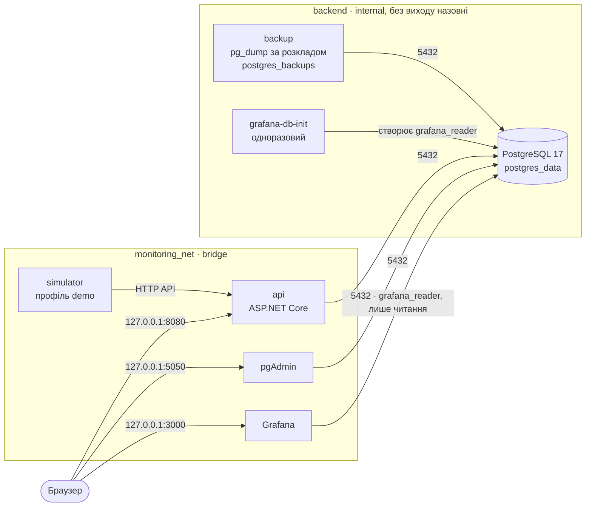

# Розгортання

Стек складається з базового `docker-compose.yaml` і шарів, що підключаються поверх нього через `-f`:

| Файл | Для чого | Сервіси |
|---|---|---|
| `docker-compose.yaml` | базовий запуск ЛР3 | `db`, `api`, `pgadmin` |
| `docker-compose.dev.yaml` | API з IDE (F5), PostgreSQL у Docker | відкриває `db` на `127.0.0.1:5432` |
| `docker-compose.prod.yaml` | продакшн-конфігурація | + `backup` |
| `docker-compose.monitoring.yaml` | дашборди (поверх prod) | + `grafana`, `grafana-db-init`, `simulator` (профіль `demo`) |

Базовий файл не змінюється: усі відмінності продакшну описані в шарах, тож `docker compose up` працює так само, як і раніше.

## Схема

`api`, `pgadmin` і `grafana` підключені до обох мереж: зовнішньої, щоб їх було видно в браузері, і `backend`, щоб дістатися бази. Сам `db` є тільки в `backend`: порт не опубліковано, а з `monitoring_net` до нього не підключитися. Перевіряє це `scripts/verify-stack.ps1`.

## Порядок старту

1. `db` стає `healthy` (`pg_isready`).
2. `api` застосовує міграції і стає `healthy`, коли `/health/ready` бачить базу. `backup` стартує паралельно після `db`.
3. `grafana-db-init` створює роль `grafana_reader` (повторний запуск нічого не ламає) і завершується з кодом 0.
4. `grafana` стартує лише після успішного `grafana-db-init`; `simulator` чекає `/health/ready`.

`docker compose up --wait` повертає керування, коли всі сервіси здорові.

## Перевірки здоров'я

| Сервіс | Перевірка |
|---|---|
| `db` | `pg_isready` |
| `api` | `GET /health/ready`, тобто API працює і є з'єднання з базою; `GET /health/live` перевіряє лише процес |
| `pgadmin` | `GET /misc/ping` |
| `grafana` | `GET /api/health` |
| `backup` | остання успішна копія не старша за два інтервали (`backup.sh --healthy`): контейнер стає unhealthy, якщо бекапи перестали створюватися |

У runtime-образі API немає curl і wget, тому перевірка в compose робить HTTP-запит через bash `/dev/tcp`. Образ при цьому не змінюється.

## Налаштування

Необов'язкові змінні `.env` (усі мають значення за замовчуванням, див. `.env.example`):

| Змінна | За замовчуванням | Що задає |
|---|---|---|
| `API_PORT`, `PGADMIN_PORT`, `GRAFANA_PORT` | `8080`, `5050`, `3000` | порти на `127.0.0.1` |
| `SWAGGER_ENABLED` | `true` | Swagger UI і `/openapi/v1.json` у продакшн-шарі |
| `BACKUP_INTERVAL_SECONDS`, `BACKUP_RETENTION_DAYS` | `86400`, `7` | розклад і термін зберігання бекапів |
| `SIMULATOR_INTERVAL_SECONDS`, `SIMULATOR_SPIKE_PROBABILITY` | `5`, `0.03` | частота показників симулятора і ймовірність викиду |
| `POSTGRES_PORT` | `5432` | порт бази для dev-шару |

## Безпека

- Паролі зберігаються в `secrets/*.txt` (у `.gitignore` і `.dockerignore`) і монтуються як Docker secrets у `/run/secrets`. У змінних середовища контейнерів паролів немає. API бере пароль із файлу (`Database__PasswordFile`), PostgreSQL і pgAdmin — через `*_FILE`, Grafana — через `__FILE` і `$__file{}`.
- Якщо в `.env` не задано обов'язкову змінну, `docker compose` одразу зупиняється з поясненням, яку саме.
- Для `api` діють такі обмеження:
  - коренева файлова система тільки для читання, `/tmp` у tmpfs;
  - запуск не від root (`$APP_UID`);
  - `cap_drop: ALL`.
- Для всіх сервісів: `no-new-privileges`, ліміти CPU і пам'яті, ротація логів (5 × 10 МБ).
- Grafana читає базу під окремою роллю `grafana_reader`:
  - тільки `SELECT`;
  - `default_transaction_read_only`;
  - `statement_timeout = 10s`.
- Усі порти прив'язані до `127.0.0.1`.

## Дані

| Volume | Що зберігає |
|---|---|
| `postgres_data` | база PostgreSQL |
| `postgres_backups` | резервні копії `pg_dump` (custom format) |
| `pgadmin_data` | налаштування pgAdmin |
| `grafana_data` | стан Grafana (дашборди й джерело даних задаються з репозиторію) |

Детальні інструкції — в [operations.md](operations.md), рішення та їх причини — в [adr/](adr/).
